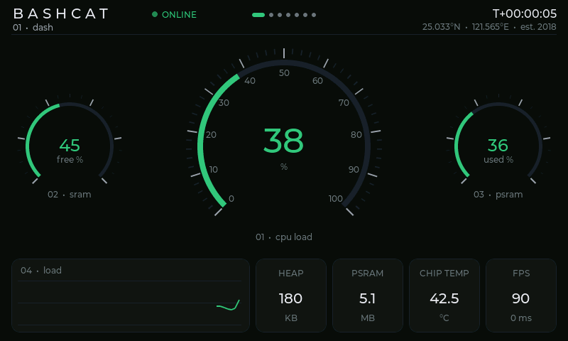
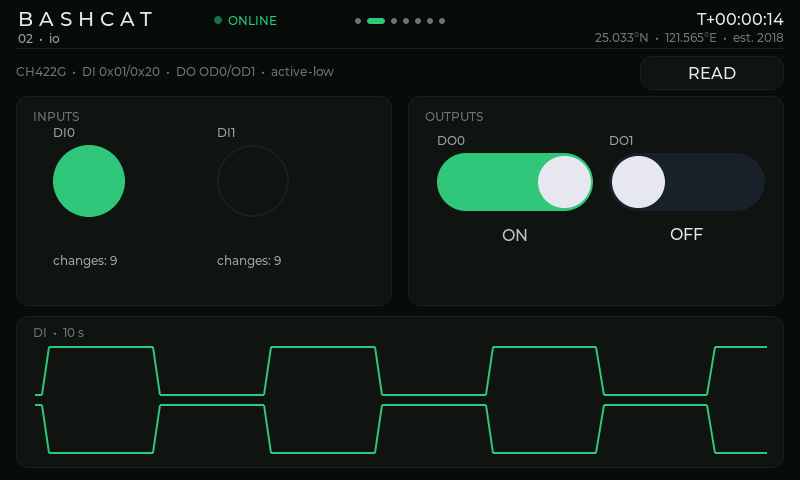
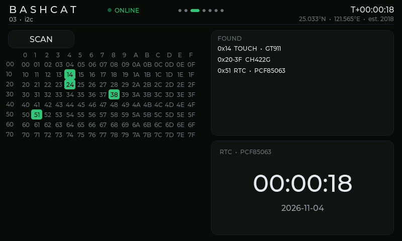
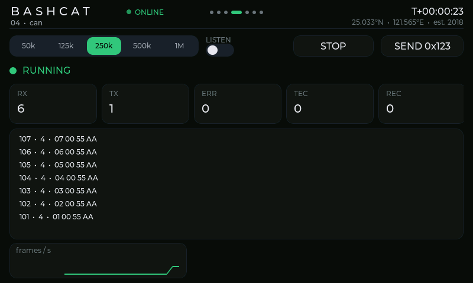
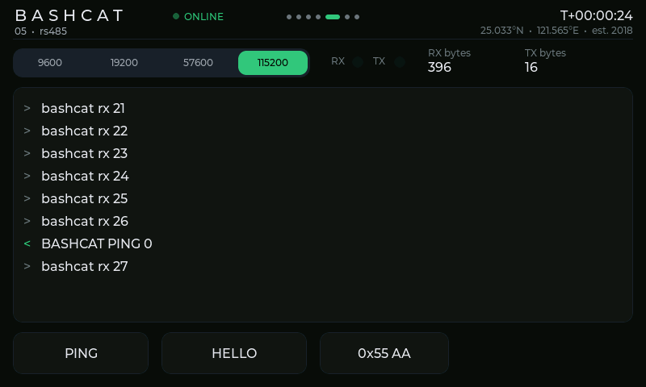
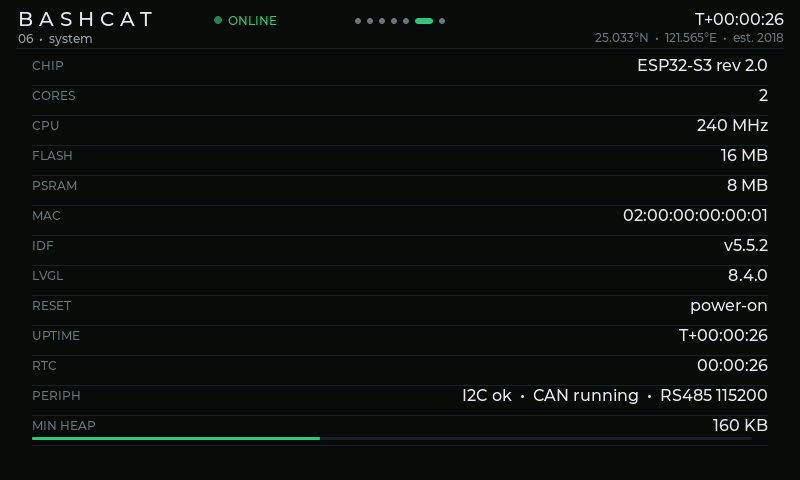
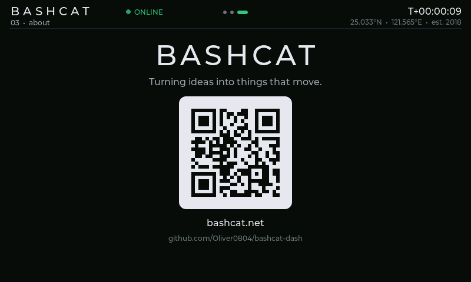
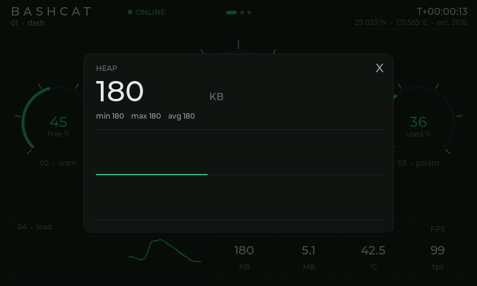

# BASHCAT Dash

**ESP32-S3 觸控儀表板韌體** · Waveshare ESP32-S3-Touch-LCD-4.3B · ESP-IDF v5.5.2 · LVGL 8.4

[bashcat.net](https://bashcat.net) 風格的工業儀表介面：深色、克制綠、扁平細線、汽車儀表式的點火自檢與平滑動畫，並且能直接操作板上的隔離 DI/DO、I2C、CAN、RS485。

> Made by **[BASHCAT](https://bashcat.net)** — 把 idea 變成可以動的東西。
> 嵌入式、韌體、AI 與產品開發合作 → **<https://bashcat.net>**


## 畫面

| | |
| --- | --- |
|  **01 · dash** CPU / SRAM / PSRAM 儀表、負載曲線、HEAP / PSRAM / 晶片溫度 / FPS |  **02 · io** 隔離 DI 指示燈（脈衝動畫）、DO 開關、10 秒 DI 時序圖 |
|  **03 · i2c** i2cdetect 式位址掃描、裝置辨識、PCF85063 RTC |  **04 · can** bitrate 切換、listen-only、即時幀列表、計數與錯誤狀態 |
|  **05 · rs485** 鮑率切換、收發終端、快速發送 |  **06 · system** 晶片、記憶體、IDF/LVGL 版本、重置原因 |
|  **07 · about** QR code 直連 bashcat.net |  點 tile 展開詳情（60 點歷史、min / max / avg） |


## 互動

- **左右滑動**切頁，點上方頁面指示器直接跳頁
- **點主儀表**切換指標（CPU → SRAM → PSRAM → 溫度），弧線先收回再掃出
- **點側邊小儀表**與主儀表交換指標
- **點底部 tile** 從原位展開詳情面板
- **60 秒無操作**進入待機（大字 uptime），觸控喚醒並重新 sweep
- io / i2c / can / rs485 頁直接操作實體週邊

## 編譯與燒錄

需要 [ESP-IDF v5.5.2](https://docs.espressif.com/projects/esp-idf/en/v5.5.2/esp32s3/get-started/index.html)。LVGL 8.4.0 與 GT911 驅動會從 ESP Component Registry 自動下載。

```bash
git clone https://github.com/Oliver0804/bashcat-dash.git
cd bashcat-dash
. $IDF_PATH/export.sh
idf.py set-target esp32s3
idf.py build
idf.py -p /dev/cu.usbmodemXXXX flash monitor
```

> **燒錄後停在 `waiting for download`？** 按一下板上 **RST** 鍵即可正常開機（原生 USB 軟體重置的已知現象，見 [docs/HARDWARE.md](docs/HARDWARE.md#已知狀況)）。

## 桌機模擬器

不需要板子，在 macOS / Linux 上用同一份 UI 程式碼離線渲染截圖與 GIF（週邊為 stub）：

```bash
idf.py reconfigure     # 先讓 managed_components/ 下載 LVGL 8.4.0
bash sim/build.sh      # 輸出到 sim/out/（PNG、boot.gif、v3.gif）
```

## 硬體參數

完整腳位、時序、CH422G 擴充 IO、DI/DO 電路與接線範例：**[docs/HARDWARE.md](docs/HARDWARE.md)**

| 週邊 | 介面 / 腳位 |
| --- | --- |
| LCD | 800×480 RGB565 並列，PCLK 16 MHz，framebuffer 在 PSRAM |
| 觸控 | GT911，I2C SDA 8 / SCL 9 |
| IO 擴充 | CH422G（背光、觸控/LCD 重置、DI/DO） |
| 隔離 DI0 / DI1 | CH422G EXIO0 / EXIO5，active-low |
| 隔離 DO0 / DO1 | CH422G OD0 / OD1，**active-low，開集極吸入 450 mA** |
| CAN | TWAI TX 15 / RX 16 |
| RS485 | UART2 TX 44 / RX 43，自動方向 |
| RTC | PCF85063 @ 0x51 |

> **DO 量不到電壓？** DO 是開集極吸入輸出，必須有電源經過負載接到 DOUT 才看得到變化，最簡單的測法是把 `DOUT0` 接到 `DI0`。詳見 [HARDWARE.md › DO](docs/HARDWARE.md#do-是開集極吸入輸出--需要電源經過負載才看得到變化)。

## 可調參數

| 文件 | 內容 |
| --- | --- |
| [main/ui/NOTES.md](main/ui/NOTES.md) | 每段動畫的函式、時間常數、閾值顏色、頁面/過場/待機參數、v3.1 效能設定 |
| [main/io/NOTES.md](main/io/NOTES.md) | 後端命令/狀態結構、CH422G 方向切換陷阱、DI 輪詢、CAN/RS485 參數 |
| [sdkconfig.defaults](sdkconfig.defaults) | `-O2`、LVGL 刷新 15 ms、cache、runtime stats、字型、QR code、snapshot |
| [docs/specs/](docs/specs/) | v1 → v3.1 的設計規格 |

## 架構

```
main/
├── main.c                    LCD/觸控初始化 → 後端 → UI
├── waveshare_rgb_lcd_port.c  RGB 面板、I2C、GT911（原廠 port，觸控改為可選）
├── lvgl_port.c               LVGL port（防撕裂 mode 3：雙緩衝 + direct mode）
├── ui/                       介面、動畫、頁面系統（只在 LVGL task 內執行）
└── io/                       週邊後端 task：CH422G DI/DO、I2C 掃描、RTC、TWAI、UART2
                              UI ↔ 後端只透過 command queue 與 snapshot（mutex）溝通
sim/                          headless LVGL 渲染器 + ESP-IDF / 後端 stub
```

## 授權

MIT © [BASHCAT](https://bashcat.net)。衍生自 Espressif / Waveshare 範例的檔案保留原 SPDX 標頭（Apache-2.0 / CC0-1.0）。

---

<p align="center"><a href="https://bashcat.net"><b>bashcat.net</b></a> · 嵌入式 · 韌體 · AI · 產品開發</p>
